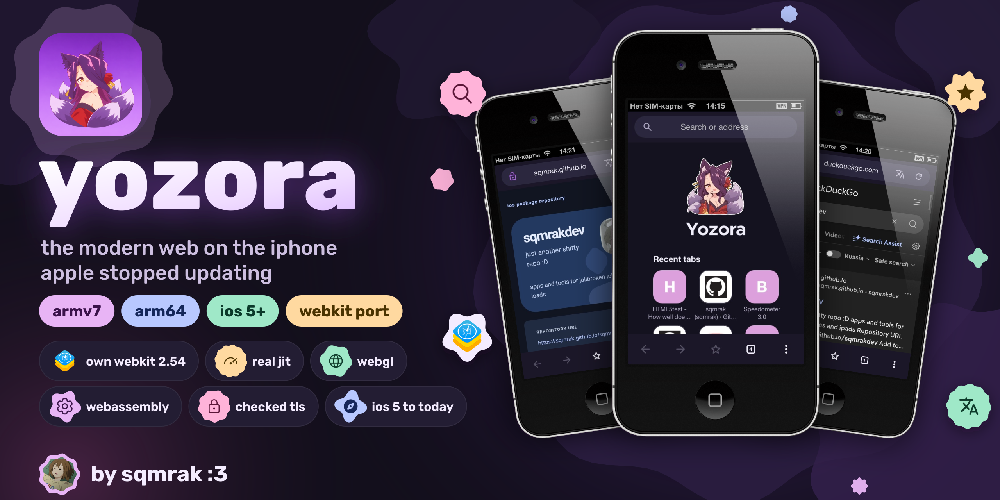

# yozora

<p align="center">
  
</p>

<p align="center"><b>the modern web on the iphone that apple stopped updating. an own webkit port, a real jit, webgl, webassembly, mediasource, one ipa, ios 5 to today</b></p>

an old phone is not slow, its browser is old. yozora throws the browser away and brings the engine: webkit 2.54.3, ported by hand to a platform it was never meant for, linked into one binary, pinned to the byte. no system webview, no remote render, no proxy that draws the page somewhere else. the page runs on the phone, in your hand.

## devices

- armv7: ios 5.0 and later
- arm64: ios 7.0 and later
- one ipa per slice, or one fat ipa with both

## engine

- webkit 2.54.3, webcore and javascriptcore from one revision, one process, no gpu process
- javascript: baseline, dfg and regexp jit on armv7 and arm64 (on arm64 a new install starts with the jit switch off, see [docs/javascript.md](docs/javascript.md)), the assembler interpreter of the same binary when the system refuses executable memory or the switch is off
- graphics: retained skia recordings per layer, a raster thread of its own, a native core animation layer tree, so scrolling and transform animations go on while a script holds the page
- text: freetype, harfbuzz, icu 78.3, site fonts in ttf, otf, woff and woff2, color emoji
- network: libcurl, openssl, http/2, brotli, an own root bundle, the chain, the host and the dates are always checked
- runtime: an own libc++ and icu, nothing is borrowed from the system
- sources and archives are checked by sha-256 before use, every patch is pinned by before and after hashes

see [docs/webkit.md](docs/webkit.md), [docs/javascript.md](docs/javascript.md), [docs/graphics.md](docs/graphics.md).

## the web platform

- webgl 1 and webgl 2 over the opengl es of the system, always on
- webassembly: an own engine for the slices that have none, the core of the 2.0 specification, bigints, streaming compile
- mediasource: fragmented mp4 from the page is cut into mpeg-ts and served to the system player as hls, h264 and aac only
- web audio: contexts, oscillators, filters, convolver, panner, worklets, decoding of wave, mp3 and aac
- websockets, workers, indexeddb, touch events, pinch zoom, selection, find in page
- geolocation, notifications, color, date, select and file controls of the page as native sheets

see [docs/webgl.md](docs/webgl.md), [docs/webassembly.md](docs/webassembly.md), [docs/media.md](docs/media.md).

## browser

- tabs, back and forward, history, bookmarks, a start page with tiles, site icons, tab previews
- material you, as in exteria: a tonal purple palette in light, dark and black, material symbols, a pill address field, cards, sheets, springs that overshoot and settle
- an accent editor that turns the whole palette to the color you pick
- incognito: a switch in the tab tray, a deep purple interface, cookies, storage, databases, cache and bytecode in memory only, gone with the last private tab
- ipad: all orientations, a tab strip above one toolbar, split view and slide over
- default browser on ios 14 and later
- links and buttons that point to another app (`tg://`, `mailto:`, `tel:`, app store links) open that app, and on ios 10 and later an https link that an installed app claims as a universal link opens there too
- another app can ask for a sign in on a site: `yozora-auth://` opens it in a private tab and gives the page address and the cookies back to that app, after the person agrees
- downloads with pause, resume, a wave progress bar, and system notifications when a file is done
- translation of pages, language, theme, text size, search engines (google, duckduckgo, yandex)
- updates: every launch the app asks GitHub for the latest release and, when it is newer, shows a card with the sticker, the versions and the notes. settings > Update has the same with the installed and the newest version and the changelog. a phone with AppSync installs it from the app, any other is sent to the release page, see [docs/updates.md](docs/updates.md)

see [docs/ui.md](docs/ui.md), [docs/tabs.md](docs/tabs.md), [docs/incognito.md](docs/incognito.md), [docs/signin.md](docs/signin.md), [docs/downloads.md](docs/downloads.md).

## blocker

- ad and tracker hosts, and rules in the syntax of adblock plus lists: anchors, wildcards, exceptions, resource types, third party, domains, element hiding
- your own rules in settings, a pause for one site from the menu, a counter of what was stopped on the page
- a rule set of 3500 rules costs 14 microseconds a request on the host

see [docs/adblock.md](docs/adblock.md).

## privacy

- cookies of third parties can be refused, javascript can be switched off, history can be switched off
- geolocation and notifications are asked once per site, the answers are kept, listed and taken back in settings
- certificates are never relaxed, a site that fails the check is an error page

see [docs/permissions.md](docs/permissions.md), [docs/network.md](docs/network.md).

## the engine of the tab

- one thread owns webcore for the whole process, the interface thread never touches it
- a tab that is left stays in memory with its forms, script state and history, its tasks suspended and its pixels dropped
- a script that holds the thread is offered to be stopped, the interface stays alive
- budgets by the memory of the phone, a warning drops the caches without waiting for the page

see [docs/core.md](docs/core.md), [docs/performance.md](docs/performance.md).

## for developers

- debug overlay: frames, scenes, cpu, memory, traffic
- a log screen that keeps the stderr of the app and the pages in a terminal card
- a switch for the jit and a line that says what javascriptcore reports
- `yozora-render`, a headless page runner with a profiler, a crash symbolizer and scripted input

see [docs/debug.md](docs/debug.md).

## troubleshooting

yozora keeps a log from the first launch, nothing has to be turned on. when something breaks, send the log with the report.

1. reproduce the problem, then open Settings > For developers > Logs. do not restart the app before this step if the problem is not a crash
2. the three tabs are the log of this run (Now), of the run before (Previous) and the crash record (Crashes). after a crash or a restart the Previous tab holds the run that went wrong, and Crashes holds the addresses of the stack
3. pick the tab, tap the copy button in the top right corner and paste the text into the issue or the message. a long log fits in a file or a gist better than in a comment
4. say the phone, the ios version, the version of yozora (Settings > About) and what you did before the problem

what is kept and where, inside the app container, `Library/Caches`:

- `yozora.log`: this run, up to 1 MB, a longer run drops its oldest lines
- `yozora-previous.log`: the run before
- `yozora-crash.log`: faults and uncaught exceptions with the screen the app was on, the last notes, registers and the stack. a crash is also written to `yozora.log`, so the log of the run before holds it too

on a jailbroken phone the files can be taken straight from the container, for example with `scp`.

the log holds the addresses of the pages that were open, so read it before posting if that matters. switch it off in Settings > For developers > Logging, the app then keeps no log and a crash leaves only `yozora-crash.log`.

## install

build the ipa, see below, and install it with your sideloading tool, or build the deb (`meow build deb`) for a jailbroken phone.

## build

```bash
meow test
meow build core-fetch core-host
meow build
```

built with [meow](https://github.com/sqmrak/meow) by sqmrak. `meow build` runs the dependency steps that are missing (`core-fetch`, `core-tools`, `core-deps`, `text-deps`, `web-deps`), builds WebKit through cmake, compiles and links the app, signs it and writes one ipa per slice. needs meow, a c99 compiler, python 3.12, cmake 3.20, ninja, c++23, ruby, perl, an ios cross toolchain with `clang`, `lipo`, `ldid`, a legacy sdk for armv7 and a patched sdk for arm64 (`meow doctor` lists what it found). a full webcore build takes about 25 minutes with four jobs and about 8 GB of ram.

outputs `build/ipa/Yozora-armv7.ipa` and `build/ipa/Yozora-arm64.ipa`, signed, and `build/ipa/Yozora.ipa` with both slices from `meow build ipa`. see [docs/build.md](docs/build.md) for every variable and target.

## docs

- [build](docs/build.md): host and ios builds, targets, variables, outputs
- [webkit](docs/webkit.md): the port, pinned sources, patches, the runtime
- [core](docs/core.md): the core thread, the c api, passes, memory warnings
- [javascript](docs/javascript.md): jit, interpreter, bytecode cache, stuck scripts
- [graphics](docs/graphics.md): scenes, raster, tiles, budgets, the layer tree
- [text](docs/text.md): fonts, emoji, shaping
- [network](docs/network.md): curl, tls, roots, cookies, cache, websockets, authentication
- [media](docs/media.md): video, the stream proxy, mediasource, audio, web audio
- [webgl](docs/webgl.md): contexts over opengl es
- [webassembly](docs/webassembly.md): the engine, the api, what is refused
- [ui](docs/ui.md): the interface, controls of pages, motion, ipad, settings
- [tabs](docs/tabs.md): tab tray, suspension, previews, memory
- [incognito](docs/incognito.md): what the private session keeps
- [signin](docs/signin.md): the sign in for another app, the link, the answer, the limits
- [adblock](docs/adblock.md): rules, the syntax, hiding, limits
- [permissions](docs/permissions.md): geolocation, notifications, site decisions
- [downloads](docs/downloads.md): pause, resume, background, notifications
- [data](docs/data.md): the profile, files, limits
- [performance](docs/performance.md): budgets, what was measured
- [tests](docs/tests.md): host, core and interface tests, what ran where
- [limits](docs/limits.md): every bound in the code, and what is not done
- [debug](docs/debug.md): switches, tools, logs
- [updates](docs/updates.md): the release check, the card, the install

## contributing

[CONTRIBUTORS.md](CONTRIBUTORS.md): the tree, the build, how to put the engine into your own app, the rules for a change.

## license

yozora is free software under the GNU General Public License version 3, see `LICENSE`. sources that it builds from and bundles keep their own licenses. app fonts: Roboto, see `app/LICENSE-Roboto.txt`. interface icons: Material Symbols, Apache 2.0, see `app/LICENSE-MaterialSymbols.txt`. root bundle: curl.se `cacert.pem`. emoji: not committed, see `app/NOTICE-Emoji.txt`.
